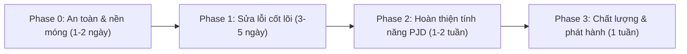

# Đánh giá toàn diện dự án VietLens (27/10/2026)

> [!NOTE]
> Đây chỉ là đánh giá, **không có file nào trong dự án bị sửa**. Tôi đã đọc code của cả 3 thành phần (JBE – Spring Boot, PaiService – FastAPI, VLensFE – Expo) rồi đối chiếu với [PJD.md](file:///c:/Project_DV/Viet_Lens/PJD.md). Tôi chưa chạy build/test.

---

## 1. Tổng quan & chấm điểm

| Hạng mục | Điểm (/10) | Nhận xét ngắn |
|---|---|---|
| Kiến trúc tổng thể | 6.5 | Tách 3 service hợp lý, nhưng FE gọi thẳng PaiService và Supabase, nên có 3 luồng dữ liệu song song |
| Backend Java (JBE) | 6.5 | Code sạch, xác thực JWKS chuẩn; schema còn nghèo so với PJD, chưa có test |
| AI Vision (PaiService) | 5 | Ý tưởng tốt (Qwen-VL + resolver + fallback), nhưng có bug fallback, bị chặn async, phụ thuộc Colab/ngrok |
| AI Chat | 4.5 | Backend hỗ trợ 4 persona, FE chỉ dùng 1; không có lịch sử hội thoại; FE tự “bịa” câu trả lời khi lỗi |
| Frontend | 5 | UI phong phú; điều hướng tự viết bằng state, i18n thiếu, nhiều tính năng là giả lập |
| Dữ liệu di sản | 3.5 | Chỉ ~172 bản ghi miền Trung; mô tả là chuỗi Q&A ghép lại; tọa độ fallback trùng Đà Nẵng |
| Bảo mật | 3 | **Có service_role key và Groq key hardcode trong code**; PaiService mở hoàn toàn |
| DevOps / Git / Test | 2 | **Gần như không có version control**, không có CI và gần như không có test |
| **Mức độ hoàn thiện so với PJD** | **≈ 45–50%** | |

---

## 2. Điểm mạnh

- **Xác thực JWT đúng chuẩn**: [JwtUtils.java](file:///c:/Project_DV/Viet_Lens/VLensBE/JBE/src/main/java/com/vietlens/security/JwtUtils.java) dùng JWKS (ES256/RS256), kiểm tra issuer và exp, cho phép lệch giờ.
- **SecurityConfig rõ ràng**: stateless, CORS giới hạn origin, endpoint public/private hợp lý.
- **Truy vấn lân cận tối ưu**: dùng Haversine kèm bounding-box pre-filter ([HeritageInfoRepository.java](file:///c:/Project_DV/Viet_Lens/VLensBE/JBE/src/main/java/com/vietlens/repository/HeritageInfoRepository.java#L84-L128)).
- **Đa ngôn ngữ ở tầng dữ liệu**: có bảng `heritage_translations`, header `Accept-Language` và batch-load bản dịch (tránh N+1).
- **Schema + RLS**: [V1__init_schema_and_rls.sql](file:///c:/Project_DV/Viet_Lens/VLensBE/V1__init_schema_and_rls.sql) có ràng buộc UNIQUE, CHECK, index và policy đầy đủ.
- **Pipeline Vision có chiều sâu**: prompt chống hallucination, từ chối ảnh ngoài miền (OOD), resolver 4 tầng (exact → alias → substring → TF-IDF Jaccard).
- **axiosClient bền vững**: refresh token có mutex, hàng đợi, retry kèm exponential backoff.
- **UI giàu tính năng**: radar scan, map MapLibre 3D + PMTiles, định tuyến OSRM, TTS.

---

## 3. Vấn đề nghiêm trọng (P0 – cần xử lý ngay)

> [!CAUTION]
> **Lộ bí mật**: Supabase **service_role key** (bỏ qua toàn bộ RLS) và **Groq API key** đang hardcode trong:
> - [seed_to_supabase.py](file:///c:/Project_DV/Viet_Lens/VLensBE/DataSeeding/seed_to_supabase.py#L9)
> - [translate_all_to_english.js](file:///c:/Project_DV/Viet_Lens/VLensBE/DataSeeding/translate_all_to_english.js#L11-L13)
> - [seed_danang_and_islands.js](file:///c:/Project_DV/Viet_Lens/VLensBE/DataSeeding/seed_danang_and_islands.js#L14)
>
> `.gitignore` hiện không chặn được các file này. **Hãy rotate cả 2 key trên Supabase Dashboard và Groq Console**, sau đó chuyển sang biến môi trường.

> [!WARNING]
> **Không có version control thực sự**: thư mục gốc và `VLensBE/` **không phải git repo**. `VLensFE/.git` chỉ có 1 commit "Initial commit" (template Expo) và toàn bộ `src/` đang untracked. Chỉ một sự cố ổ đĩa là mất toàn bộ backend.

| # | Vấn đề | Vị trí | Tác động |
|---|---|---|---|
| P0-1 | Fallback EfficientNet **không bao giờ chạy** khi Qwen mất kết nối: `call_qwen_vision_server` ném `HTTPException`, còn `run_inference` lại `except HTTPException: raise` | [app.py:L410-L422, L636-L647](file:///c:/Project_DV/Viet_Lens/VLensBE/PaiService/app.py#L636-L647) | Colab/ngrok tắt là quét AI chết hoàn toàn |
| P0-2 | Endpoint `async def` gọi `requests.post` đồng bộ (tối đa 35s), làm chặn event loop | [app.py:L776-L811](file:///c:/Project_DV/Viet_Lens/VLensBE/PaiService/app.py#L776-L811) | Một request chậm làm treo mọi request khác |
| P0-3 | Guest mode là giả: `id:'guest'`, không có token Supabase | [AuthScreen.jsx:L210-L218](file:///c:/Project_DV/Viet_Lens/VLensFE/src/screens/AuthScreen.jsx#L210-L218) | Khách bị 401 khi chat, bookmark hay review mà không nhận được báo lỗi rõ ràng |
| P0-4 | Khi API lỗi, Chat **tự sinh câu trả lời “AI” giả** bằng if/else keyword | [ChatScreen.jsx:L188-L207](file:///c:/Project_DV/Viet_Lens/VLensFE/src/screens/ChatScreen.jsx#L188-L207) | Thông tin lịch sử sai lệch, người dùng bị đánh lừa |
| P0-5 | Bản đồ **không hiển thị marker di sản từ DB**, chỉ hiện 1 điểm `focusedSite` | [MapScreen.jsx:L39-L50](file:///c:/Project_DV/Viet_Lens/VLensFE/src/screens/MapScreen.jsx#L39-L50) | Tính năng cốt lõi 3.8 trong PJD không hoạt động |
| P0-6 | **Không dùng GPS**: `expo-location` đã cài nhưng không được import ở đâu; vị trí hardcode Đà Nẵng | [HomeScreen.jsx:L46](file:///c:/Project_DV/Viet_Lens/VLensFE/src/screens/HomeScreen.jsx#L46), [MapScreen.jsx:L36](file:///c:/Project_DV/Viet_Lens/VLensFE/src/screens/MapScreen.jsx#L36) | “Di sản lân cận”, “Recenter” và “Chỉ đường” đều sai vị trí |
| P0-7 | Fallback IP Android `172.16.0.255` (địa chỉ broadcast, không hợp lệ) | [aiVisionService.js:L12](file:///c:/Project_DV/Viet_Lens/VLensFE/src/services/aiVisionService.js#L12) | Thiếu `.env` là quét AI hỏng ngay |

---

## 4. Đối chiếu PJD với hiện trạng

| Phân hệ PJD | Trạng thái | Ghi chú |
|---|---|---|
| 3.1 Onboarding & quyền | 🟡 Một phần | Có slide xin quyền nhưng không gọi API xin quyền; onboarding hiện lại mỗi lần chưa đăng nhập |
| 3.1 Bottom tab, ẩn khi có bàn phím | ✅ | Navigation tự viết bằng state, không có xử lý nút Back của Android |
| 3.2 Đăng nhập/Đăng ký email | ✅ | Thiếu chức năng quên mật khẩu |
| 3.2 Guest mode | ❌ Giả lập | Xem P0-3 |
| 3.2 User sync / role | ✅ | Chưa dùng role ADMIN ở đâu |
| 3.3 Lọc danh mục | 🟡 | Chỉ 3 nhóm hardcode, chưa khớp 5 nhóm của PJD |
| 3.3 Lọc theo triều đại | ❌ | DB không có cột `era/dynasty` |
| 3.3 Live search + debounce | ✅ | Chưa tìm theo tên tiếng Anh |
| 3.3 Di sản lân cận (GPS, 15–50km) | ❌ | Tọa độ hardcode |
| 3.3 Bộ sưu tập chuyên đề | ❌ | Chưa có |
| 3.4 Camera, gallery, flash, đổi camera | ✅ | |
| 3.4 Nhận diện AI | 🟡 | Phụ thuộc Colab ngrok; `era/dynasty` bị gán bằng `category` ([CameraScanScreen.jsx:L143-L144](file:///c:/Project_DV/Viet_Lens/VLensFE/src/screens/CameraScanScreen.jsx#L143-L144)) |
| 3.5 Chi tiết: verified history, key figures, resonance score | ❌ | Entity chỉ có 9 cột, xem mục 5 |
| 3.6 Audio Guide TTS | 🟡 | DetailScreen có vi/en; Chat cố định `vi-VN` |
| 3.7 4 Persona AI | ❌ | Backend có đủ 4, FE hardcode `'GUIDE'`; tên “GS. Lê Văn Lan” trong PJD ≠ “GS Trần Quốc Lân” trong code |
| 3.7 Quick prompts theo di tích | 🟡 | 4 câu cố định |
| 3.8 Bản đồ có marker từ DB | ❌ | Xem P0-5 |
| 3.8 Hoàng Sa / Trường Sa | 🟡 | Có file SQL seed nhưng bản đồ không hiển thị marker |
| 3.9 Hộ chiếu, tem | ❌ Giả lập | Tem chỉ đếm số bookmark; “Học Giả Cố Đô” luôn `unlocked: true` ([PassportScreen.jsx:L64](file:///c:/Project_DV/Viet_Lens/VLensFE/src/screens/PassportScreen.jsx#L64)); không có bảng visit/check-in |
| 3.9 Điểm văn hóa & cấp bậc | ❌ | Chưa có |
| 3.10 Review & rating | ✅ | Chưa phân trang, chưa giới hạn độ dài comment, chưa có xóa |
| 3.10 Bookmark | ✅ | Danh sách bookmark không trả bản dịch EN |
| 3.11 i18n VI/EN | 🟡 | Auth, Chat, Map, Onboarding, Passport có 0 lần gọi `t()` |
| 3.11 Dark mode | ❌ | Switch chỉ đổi state, không đổi giao diện |
| 3.11 Góp ý / liên hệ | ❌ Giả lập | Chỉ hiện Alert “đã gửi” |

---

## 5. Phát hiện chi tiết theo thành phần

### 5.1 Backend Java – `VLensBE/JBE`
- **Schema thiếu so với PJD §4**: [HeritageInfo.java](file:///c:/Project_DV/Viet_Lens/VLensBE/JBE/src/main/java/com/vietlens/entity/HeritageInfo.java) chưa có `english_name`, `era`, `dynasty`, `verified_history`, `architectural_features`, `key_figures`, `tags`.
- `ddl-auto: update` là mặc định ([application.yaml:L22](file:///c:/Project_DV/Viet_Lens/VLensBE/JBE/src/main/resources/application.yaml#L22)). Hibernate tự sửa schema trên Supabase dễ xung đột với migration SQL/RLS. Nên chuyển sang `validate` và dùng Flyway.
- Project ref Supabase hardcode làm giá trị mặc định trong `application.yaml` và `JwtUtils`.
- Nhánh HS256 không kiểm tra `issuer` ([JwtUtils.java:L112-L130](file:///c:/Project_DV/Viet_Lens/VLensBE/JBE/src/main/java/com/vietlens/security/JwtUtils.java#L112-L130)).
- AI chat chỉ là single-turn, không có lịch sử hội thoại hay rate-limit. RAG mới chỉ nạp 1 description vào prompt.
- `/api/passport/**` đã khai báo trong Security nhưng chưa có controller.
- `getById` không loại các mục ẩm thực/lễ hội, trong khi các API danh sách thì có loại.
- `GET /api/heritage/all` không phân trang trả toàn bộ danh sách.
- Keyword search không escape ký tự `%`/`_`; dùng `LIKE '%..%'` trên `description` nên không tận dụng được index (cần `pg_trgm` hoặc FTS).
- PJD ghi Java 17/Spring Boot 3.x, thực tế là Java 21/Spring Boot 4.1.1. PJD ghi Llama 3, code dùng `openai/gpt-oss-120b`.
- **Test**: chỉ có `BeApplicationTests` (load context).

### 5.2 PaiService – `VLensBE/PaiService`
- Bug fallback (P0-1) và blocking async (P0-2).
- Không có auth, `CORS *`, không rate-limit; upload multipart không giới hạn kích thước.
- Phụ thuộc Qwen trên Colab qua ngrok nên không ổn định cho demo hay production.
- Prompt tham chiếu chỉ nạp 80 tên đầu tiên ([app.py:L371](file:///c:/Project_DV/Viet_Lens/VLensBE/PaiService/app.py#L371)).
- Khi Qwen nhận ra địa danh không có trong DB, API vẫn trả `recognized=True` với `heritage_id=None`. FE khi đó không mở được Detail/Chat thật.
- `/api/v1/health` gọi Qwen mỗi lần được hỏi.
- `/tiles` phục vụ file PMTiles 318MB với đường dẫn hardcode `C:\Project_DV\...`.
- `requirements.txt` không pin version.
- [test_qwen_integration.py](file:///c:/Project_DV/Viet_Lens/VLensBE/PaiService/test_qwen_integration.py) không phải test thật: chỉ print, gọi DB live, và bài OOD là assert hiển nhiên đúng.

### 5.3 Frontend – `VLensFE`
- **Navigation tự viết** bằng `useState` trong [App.jsx](file:///c:/Project_DV/Viet_Lens/VLensFE/App.jsx): không có BackHandler, không deep-link, mỗi lần đổi tab là unmount màn hình. [AGENTS.md](file:///c:/Project_DV/Viet_Lens/VLensFE/AGENTS.md) yêu cầu dùng Expo Router.
- **3 nguồn dữ liệu song song**: Spring API, Supabase trực tiếp ([useHeritageSites.js](file:///c:/Project_DV/Viet_Lens/VLensFE/src/hooks/useHeritageSites.js), hiện không được dùng) và mock [culturalSites.js](file:///c:/Project_DV/Viet_Lens/VLensFE/src/data/culturalSites.js) (44KB).
- Thiếu tọa độ thì adapter gán mặc định Đà Nẵng, thiếu id thì gán `Math.random()` id ([heritageAdapter.js:L34-L46](file:///c:/Project_DV/Viet_Lens/VLensFE/src/utils/heritageAdapter.js#L34-L46)).
- ChatScreen dò UUID bằng cách tải **toàn bộ** danh sách rồi so khớp `includes` theo tên.
- Token đang được gửi kèm trong body của `/api/users/sync`, không cần thiết.
- Dead code: `TodosScreen`, `UserProfileExample`, `useUserProfile`, `useHeritageSites`.
- File lớn (CameraScanScreen 1200 dòng, MapScreen 800 dòng), cần tách component.
- Không có TypeScript, ESLint hay test.
- `app.json`: name/slug vẫn là `VLensFE`, package là `com.anonymous.VLensFE`; thiếu quyền Location; có `RECORD_AUDIO` nhưng không dùng.
- Map tải MapLibre/PMTiles từ `unpkg` CDN nên không chạy được offline.

### 5.4 Dữ liệu
- Mô tả di sản là chuỗi “- câu hỏi + trả lời” ghép từ dataset VQA, không phải bài thuyết minh.
- Tên lấy từ tên thư mục (`.title()`); địa danh nào geocode thất bại bị gán tọa độ Đà Nẵng.
- Dữ liệu chỉ có miền Trung, trong khi PJD và màn hình Map định vị là toàn quốc.

### 5.5 Vận hành
- Thư mục gốc có 16 file `hs_err_pid*.log` / `replay_pid*.log` (JVM crash, có thể do thiếu RAM).
- Không có README tổng, docker-compose hay CI.
- Không thống nhất port: mock Qwen mặc định `127.0.0.1:8080` trùng port Spring Boot 8080.

---

## 6. Lộ trình đề xuất

Các prompt giao cho agent theo từng phase nằm ở file [bo_prompt_agent_vietlens.md](file:///C:/Users/ADMIN/.gemini/antigravity-ide/brain/07a0b207-bd09-49b2-8815-47337d3cfb27/bo_prompt_agent_vietlens.md).
