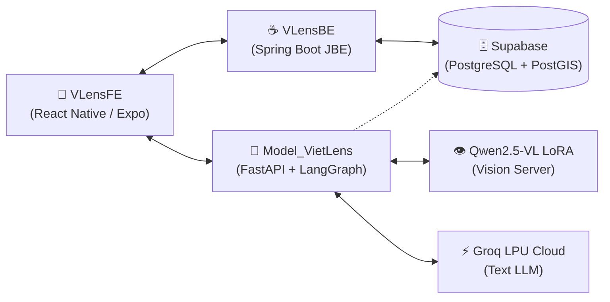
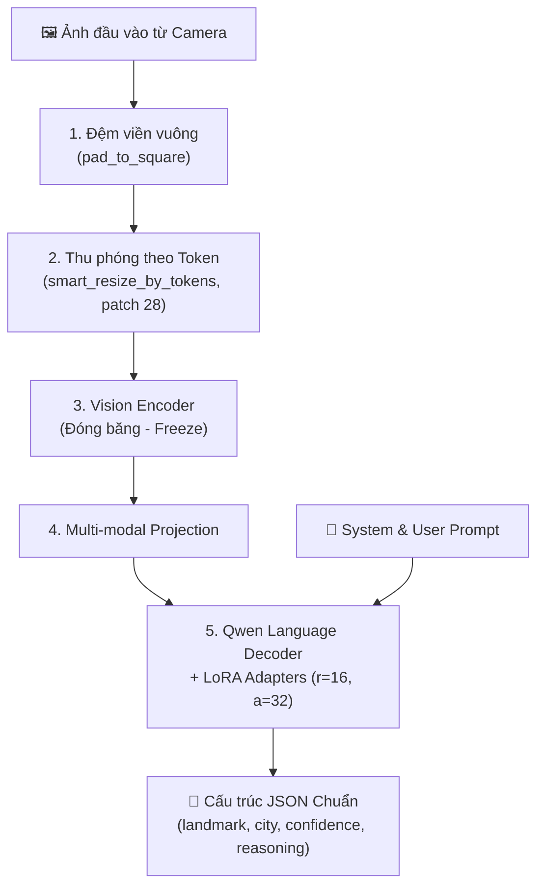
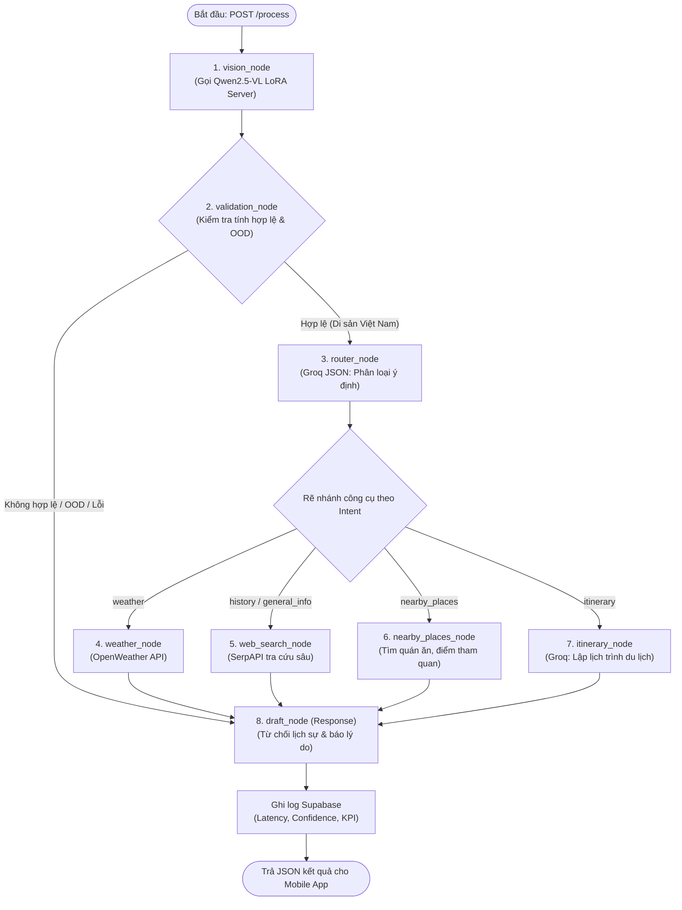
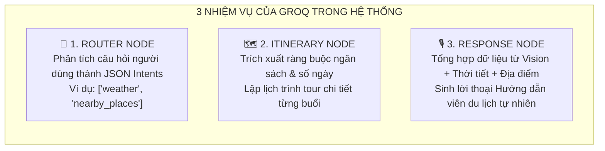
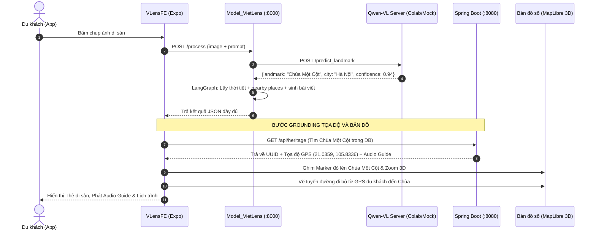

# CẨM NANG TOÀN DIỆN VỀ MÔ HÌNH VÀ KIẾN TRÚC VIETLENS (LANDMARK GUIDE)

> **Tài liệu tham chiếu kỹ thuật chuyên sâu:** Giải thích cơ chế hoạt động của mô hình Multimodal AI, bộ dữ liệu huấn luyện MQA, cấu hình tham số LoRA/QLoRA, vai trò của Groq API, và lộ trình tích hợp hệ thống vào dự án `Viet_Lens`.

---

## MỤC LỤC
1. [Tổng quan Kiến trúc Hệ sinh thái Multimodal Agentic AI](#1-tổng-quan-kiến-trúc-hệ-sinh-thái-multimodal-agentic-ai)
2. [Bộ Dữ liệu Huấn luyện Vietnam_Landmark_MQA_Dataset (Kaggle)](#2-bộ-dữ-liệu-huấn-luyện-vietnam_landmark_mqa_dataset-kaggle)
3. [Kiến trúc & Cơ chế Hoạt động của Mô hình Thị giác Qwen2.5-VL](#3-kiến-trúc--cơ-chế-hoạt-động-của-mô-hình-thị-giác-qwen25-vl)
4. [Cấu hình Tham số Huấn luyện LoRA / QLoRA Thực tế](#4-cấu-hình-tham-số-huấn-luyện-lora--qlora-thực-tế)
5. [Cơ chế Hoạt động của Model_VietLens (Mục Riêng Biệt)](#5-cơ-chế-hoạt-động-của-model_vietlens-mục-riêng-biệt)
6. [Tại sao phải dùng Groq API? Sứ mệnh & Nhiệm vụ](#6-tại-sao-phải-dùng-groq-api-sứ-mệnh--nhiệm-vụ)
7. [Từ điển Thuật ngữ & Khái niệm Mô hình (Glossary)](#7-từ-điển-thuật-ngữ--khái-niệm-mô-hình-glossary)
8. [Hướng dẫn Tích hợp Mô hình LoRA vào Dự án Viet_Lens](#8-hướng-dẫn-tích-hợp-mô-hình-lora-vào-dự-án-viet_lens)

---

## 1. TỔNG QUAN KIẾN TRÚC HỆ SINH THÁI MULTIMODAL AGENTIC AI

Dự án `Viet_Lens` được thiết kế nhằm giải quyết bài toán cốt lõi trong du lịch thông minh: **Khi du khách đứng trước một di sản văn hóa xa lạ, làm thế nào để họ vừa có thể nhận diện ngay công trình đó qua camera, vừa nhận được câu trả lời chính xác, vừa được dẫn đường thực tế trên bản đồ mà không bị ảo giác AI (Hallucination)?**

Hệ thống được tổ chức thành 4 khối chức năng cộng sinh chặt chẽ:



1. **`VLensFE` (Frontend di động):** Trải nghiệm người dùng di động (iOS/Android), camera radar scan, bản đồ vector 3D tương tác, audio thuyết minh và giao diện chat AI.
2. **`Model_VietLens` (AI Microservice Engine):** Trung tâm điều phối Agentic AI xây dựng bằng **LangGraph**. Phân tích đa phương thức (Ảnh + Chữ), điều phối công cụ thời tiết, địa điểm lân cận và lập lộ trình.
3. **`Qwen2.5-VL LoRA` (Vision Server):** Mô hình VLM được tinh chỉnh riêng bằng LoRA để nhận diện các danh lam thắng cảnh và di tích tại Việt Nam.
4. **`VLensBE` & `Supabase` (Grounding & Core Backend):** Nguồn chân lý duy nhất lưu trữ tọa độ GPS chuẩn xác, cơ sở dữ liệu di sản đã được kiểm duyệt lịch sử, bản dịch đa ngôn ngữ và tài khoản người dùng.

---

## 2. BỘ DỮ LIỆU HUẤN LUYỆN VIETNAM_LANDMARK_MQA_DATASET (KAGGLE)

Bộ dữ liệu nằm tại `Data For Training/Vietnam_Landmark_MQA_Dataset`, được tải từ nền tảng Kaggle (`vietnam-landmark-mqa-dataset`), là tài nguyên quan trọng bậc nhất để chuyển đổi một mô hình quốc tế tổng quát thành mô hình chuyên sâu cho di tích Việt Nam.

### 2.1. Ý nghĩa tên gọi MQA
* **MQA** là viết tắt của **Multimodal Question Answering** (Hỏi - Đáp Đa Phương Thức). 
* Khác với bài toán phân loại ảnh thông thường (Image Classification - chỉ xuất ra 1 nhãn số/tên), MQA tiếp nhận đầu vào gồm **Hình ảnh thực địa + Câu hỏi ngôn ngữ tự nhiên** và huấn luyện mô hình xuất ra câu trả lời có ngữ cảnh lịch sử, địa lý và lập luận thị giác.

### 2.2. Nguồn gốc dữ liệu
Bộ dữ liệu được trích xuất, làm sạch và tổng hợp từ **Google Landmarks Dataset v2 (GLDv2)** – kho dữ liệu địa danh quy mô lớn nhất thế giới do Google và Tổ chức Thị giác Máy tính (CVDF) công bố. Nhóm phát triển đã tiến hành:
1. Lọc toàn bộ các địa danh thuộc lãnh thổ Việt Nam.
2. Làm sạch nhiễu, loại bỏ các ảnh mờ, ảnh chụp sai lệch.
3. Tổng hợp thành các cuộc hội thoại đa phương thức có cấu trúc theo chuẩn huấn luyện của VLM thế hệ mới.

### 2.3. Cấu trúc thư mục và các file dữ liệu

```
Vietnam_Landmark_MQA_Dataset/
├── landmark_vietnam_dataset_split/
│   ├── train/     # Thư mục ảnh huấn luyện (~4,389 ảnh, chia theo ID địa danh)
│   ├── val/       # Thư mục ảnh kiểm định chất lượng trong khi train
│   └── test/      # Thư mục ảnh đánh giá độc lập sau khi train xong
├── train_vietnam_landmark.jsonl # Kịch bản Q&A và nhãn cho tập train
├── val_vietnam_landmark.jsonl   # Kịch bản Q&A và nhãn cho tập validation
└── test_vietnam_landmark.jsonl  # Kịch bản Q&A và nhãn cho tập test
```

#### Chi tiết thư mục ảnh `landmark_vietnam_dataset_split/`
* Trong mỗi tập (`train`, `val`, `test`), ảnh được gom vào các folder mang tên là **Số định danh (Landmark ID)**, ví dụ: `10363`, `104622`, `10877`...
* Mỗi folder số chứa nhiều góc chụp khác nhau của cùng một địa danh (ví dụ `train_10363_1.jpg`, `train_10363_10.jpg`): chụp chính diện, chụp nghiêng, chụp ban ngày, lúc hoàng hôn. Việc này giúp mô hình nhận diện bền bỉ (robust), không bị phụ thuộc vào góc chụp của điện thoại người dùng.

#### Chi tiết 3 file JSONL (`.jsonl` - JSON Lines)
Mỗi dòng trong file `.jsonl` là một đối tượng JSON đại diện cho một mẫu huấn luyện đối thoại chuẩn:

```json
{
  "image": "10363/train_10363_1.jpg",
  "messages": [
    {
      "role": "system",
      "content": [
        {"type": "text", "text": "You are a highly capable AI assistant specialized in identifying global landmarks."}
      ]
    },
    {
      "role": "user",
      "content": [
        {"type": "image"},
        {"type": "text", "text": "Could you tell me the specific name of this landmark?"}
      ]
    },
    {
      "role": "assistant",
      "content": [
        {"type": "text", "text": "Based on the visual features, this is Pham Ngu Lao Street, Ho Chi Minh City."}
      ]
    }
  ]
}
```

* `"image"`: Trỏ trực tiếp tới tệp ảnh vật lý trong thư mục tương ứng.
* `"role": "system"`: Định hình phong cách của trợ lý AI chuyên về địa danh.
* `"role": "user"`: Giả lập câu hỏi phong phú của khách du lịch (`Could you tell me...`, `What is this place?`, `Where is this located?`).
* `"role": "assistant"`: **Ground Truth (Đáp án mẫu)** cung cấp tên di tích, thành phố và lập luận nhận diện dựa trên đặc điểm hình ảnh (`Based on visual features...`).

---

## 3. KIẾN TRÚC & CƠ CHẾ HOẠT ĐỘNG CỦA MÔ HÌNH THỊ GIÁC QWEN2.5-VL

Mô hình nền tảng được lựa chọn là **`Qwen/Qwen2.5-VL-3B-Instruct`** của Alibaba Cloud. Đây là mô hình thị giác - ngôn ngữ (VLM) kích thước nhỏ gọn (3 tỷ tham số) nhưng có năng lực vượt trội về nhận diện không gian và đọc hiểu văn bản trong ảnh.



### 3.1. Pipeline tiền xử lý ảnh thông minh (Image Preprocessing)
Trong notebook huấn luyện `landmark-qwen2-5-vl-finetune.ipynb`, ảnh không bị nén méo (stretch) mà được xử lý qua 2 hàm chuyên biệt:

1. **`pad_to_square(img)`**: 
   * Tìm cạnh lớn nhất $\max(w, h)$ và đệm các dải màu đen ở hai bên hoặc trên/dưới để biến ảnh thành hình vuông.
   * **Mục đích:** Giữ nguyên tỷ lệ khung hình thực tế của các công trình kiến trúc (như tháp chuông cao vút hay cổng đình dài ngang), chống hiện tượng biến dạng làm AI nhận diện sai.
2. **`smart_resize_by_tokens(img, target_tokens=196)`**:
   * Quy hoạch kích thước ảnh dựa trên đơn vị `PATCH_SIZE = 28` (mỗi patch tương đương $28 \times 28$ pixel).
   * Thu nhỏ cạnh dài để số lượng visual tokens chỉ xấp xỉ 196 tokens ($392 \times 392$ px).
   * **Mục đích:** Giảm thiểu tối đa bộ nhớ VRAM, giúp mô hình suy luận siêu tốc mà vẫn giữ được các nét hoa văn, mái ngói kiến trúc đặc trưng.

### 3.2. Cơ chế suy luận thị giác & Xuất kết quả có cấu trúc
Khác với các chatbot chung chung chỉ sinh văn bản tự do, mô hình được định hướng qua `VISION_SYSTEM_PROMPT` để sinh ra JSON cấu trúc phục vụ trực tiếp cho phần mềm:

```json
{
  "landmark_name": "Chùa Một Cột",
  "city": "Hà Nội",
  "country": "Việt Nam",
  "reasoning_confidence": 0.94,
  "vision_reasoning": "Nhận diện kiến trúc đặc trưng chùa bằng gỗ hình bông sen đặt trên một cột đá giữa hồ Linh Chiểu.",
  "alternative_candidates": ["Chùa Trấn Quốc", "Chùa Tây Phương"]
}
```

### 3.3. Cơ chế phòng vệ ngoài miền (Out-Of-Domain / OOD Guardrails)
Mô hình được huấn luyện nguyên tắc nghiêm ngặt: Nếu người dùng gửi ảnh chụp selfie cận cảnh khuôn mặt, ảnh thú cưng, đồ ăn hay tài liệu:
* Mô hình bắt buộc phải trả về: `"landmark_name": "OUT_OF_DOMAIN"`.
* Giải thích lý do trong `vision_reasoning`: *"Hình ảnh chứa thông tin nhận diện cá nhân hoặc không thuộc danh lam thắng cảnh."*
* Tuyệt đối không đoán mò hay bịa đặt địa danh cho ảnh rác.

---

## 4. CẤU HÌNH THAM SỐ HUẤN LUYỆN LORA / QLORA THỰC TẾ

Toàn bộ quá trình tinh chỉnh (Fine-tuning) được thực hiện bằng kỹ thuật **QLoRA (Quantized Low-Rank Adaptation)** trên môi trường GPU Tesla T4 (16GB VRAM) của Kaggle/Colab. Dưới đây là các thông số chính xác 100% trích xuất từ file `landmark-qwen2-5-vl-finetune.ipynb`:

### 4.1. Cấu hình Lượng tử hóa 4-bit (BitsAndBytesConfig)
```python
bnb_config = BitsAndBytesConfig(
    load_in_4bit=True,
    bnb_4bit_use_double_quant=True,
    bnb_4bit_quant_type="nf4",
    bnb_4bit_compute_dtype=torch.bfloat16
)
```
* **`load_in_4bit=True` & `nf4` (NormalFloat 4):** Nén toàn bộ trọng số của mô hình nền 3B từ 16-bit (khoảng 6.5GB VRAM) xuống còn 4-bit (~2.2GB VRAM), giúp mô hình chạy vừa vặn trên các GPU tầm trung.
* **`bnb_4bit_use_double_quant=True`:** Lượng tử hóa lần 2 trên chính các hằng số lượng tử, tiết kiệm thêm ~0.4 bit/tham số.
* **`bnb_4bit_compute_dtype=torch.bfloat16`:** Các phép tính đạo hàm trong quá trình forward/backward vẫn được thực hiện ở định dạng `bfloat16` để đảm bảo độ chính xác tính toán và chống tràn số (NaN Loss).

### 4.2. Chiến lược đóng băng Vision Backbone (Freeze Strategy)
```python
for name, param in model.named_parameters():
    if "vision" in name:
        param.requires_grad = False
```
* **Tại sao phải đóng băng?** Khối Vision Encoder của Qwen2.5-VL đã được Alibaba huấn luyện trước trên hàng tỷ bức ảnh, khả năng nhận diện hình học (đường nét, màu sắc, góc cạnh) đã rất xuất sắc. Việc đóng băng toàn bộ tham số thị giác giúp:
  1. Tránh hiện tượng **Catastrophic Forgetting** (quên các đặc trưng ảnh tổng quát).
  2. Giảm hơn 60% lượng gradient cần tính toán, ngăn ngừa triệt để lỗi tràn VRAM (Out-Of-Memory) trên GPU T4.

### 4.3. Bảng tham số LoRA Adapter (`LoraConfig`)
```python
lora_config = LoraConfig(
    r=16,
    lora_alpha=32,
    target_modules=["q_proj", "k_proj", "v_proj", "o_proj", "gate_proj", "up_proj", "down_proj"],
    lora_dropout=0.05,
    bias="none",
    task_type="CAUSAL_LM"
)
```

| Tham số | Giá trị | Ý nghĩa kỹ thuật |
| :--- | :--- | :--- |
| **`r` (Rank)** | **`16`** | Số chiều không gian tiềm ẩn của 2 ma trận phân rã tích bậc thấp $A$ và $B$. Rank 16 là điểm cân bằng hoàn hảo giữa khả năng học tri thức mới và dung lượng bộ nhớ. |
| **`lora_alpha`** | **`32`** | Hệ số co giãn (Scaling factor). Tỷ lệ $\frac{\alpha}{r} = \frac{32}{16} = 2.0$ giúp khuếch đại tín hiệu cập nhật trọng số của LoRA, giúp mô hình thích ứng nhanh với tập dữ liệu di tích Việt Nam. |
| **`target_modules`** | **7 modules** | Can thiệp toàn diện vào cả khối **Multi-Head Attention** (`q_proj`, `k_proj`, `v_proj`, `o_proj`) lẫn khối **Feed-Forward MLP** (`gate_proj`, `up_proj`, `down_proj`). Giúp mô hình vừa hiểu được liên kết thị giác, vừa ghi nhớ được tên riêng tiếng Việt. |
| **`lora_dropout`** | **`0.05`** | Tỷ lệ dropout 5% trong quá trình huấn luyện nhằm chống học vẹt (overfitting). |
| **`bias`** | **`"none"`** | Không tối ưu thêm vector bias để giữ adapter gọn nhẹ nhất có thể (~50MB). |

### 4.4. Cấu hình Huấn luyện (`SFTConfig`)
* **Optimizer:** `paged_adamw_8bit` (tự động chuyển trạng thái optimizer sang RAM hệ thống khi VRAM bị căng).
* **Learning Rate:** $1\times 10^{-5}$ với `cosine` learning rate scheduler và 30 bước khởi động (`warmup_steps = 30`).
* **Batch Size thực tế (Effective Batch Size):**
  $$\text{Effective Batch Size} = \text{per\_device\_train\_batch\_size} (2) \times \text{gradient\_accumulation\_steps} (4) = 8$$
* **Cơ chế chống lỗi:** Tích hợp `NaNCallback()` để dừng khẩn cấp nếu loss vọt quá 100 và `EarlyStoppingCallback(patience=5)` tự ngắt train khi validation loss ngừng cải thiện.

---

## 5. CƠ CHẾ HOẠT ĐỘNG CỦA MODEL_VIETLENS (MỤC RIÊNG BIỆT)

`Model_VietLens` là một hệ thống Agentic AI hoàn chỉnh, chạy độc lập tại cổng `8000` thông qua framework **FastAPI** và thư viện đồ thị trạng thái **LangGraph**.

Nó không đơn thuần là gọi một model AI duy nhất, mà là một **dây chuyền làm việc thông minh gồm 8 Node nghiệp vụ**:



### Chi tiết nhiệm vụ của từng Node trong LangGraph:

1. **`vision_node`:**
   * Tiếp nhận file ảnh nhị phân được upload lên từ điện thoại.
   * Chuyển tiếp ảnh tới `VisionClient` (`PINGGY_URL/predict_landmark` trên Colab hoặc Mock Server).
   * Thu về kết quả nhận diện: tên địa danh, thành phố, độ tin cậy và lý do thị giác.
2. **`validation_node`:**
   * Đóng vai trò chốt chặn an toàn: Kiểm tra nếu `landmark_name == "OUT_OF_DOMAIN"` hoặc độ tin cậy quá thấp $\rightarrow$ Lập tức ngắt luồng chuyển thẳng đến `draft_node` để thông báo từ chối, **không gọi các công cụ tốn kém phía sau**.
3. **`router_node` (Powered by Groq):**
   * Nếu ảnh là di sản hợp lệ, Node này dùng Groq LLM đọc câu hỏi của người dùng (ví dụ: *"Ở đây có quán ăn nào ngon và thời tiết thế nào?"*).
   * Xuất ra danh sách mảng ý định: `intents: ["weather", "nearby_places"]`.
4. **`weather_node`:**
   * Lấy `city` vừa nhận diện từ ảnh, gọi API OpenWeather để lấy nhiệt độ thực tế, độ ẩm, tình trạng mưa/nắng.
5. **`nearby_places_node` & `web_search_node`:**
   * Sử dụng Google Places / SerpAPI để tìm kiếm các địa điểm ăn uống, vui chơi và thông tin lịch sử chuyên sâu quanh di tích đó.
6. **`itinerary_node` (Powered by Groq):**
   * Nếu người dùng yêu cầu lên lịch trình, node này phân tích ngân sách (`budget`) và số ngày (`duration_days`) để phân bổ các điểm tham quan hợp lý theo từng ngày.
7. **`draft_node` / `response_node` (Powered by Groq):**
   * Tổng hợp toàn bộ kết quả từ các node công cụ thành một bài hướng dẫn du lịch hoàn chỉnh, văn phong truyền cảm hứng, ngắn gọn, chuẩn xác.
8. **Logging Background Task:**
   * Ghi nhận tự động `request_id`, thời gian phản hồi (latency), độ tin cậy (confidence) vào database Supabase để hiển thị Dashboard quản trị.

---

## 6. TẠI SAO PHẢI DÙNG GROQ API? SỨ MỆNH & NHIỆM VỤ

Nhiều người thường đặt câu hỏi: *"Đã có mô hình Qwen2.5-VL rồi, tại sao lại phải tích hợp thêm Groq API?"*

### 6.1. Ba lý do sống còn phải dùng Groq Cloud
1. **Tốc độ suy luận thần tốc nhờ phần cứng LPU (Language Processing Unit):**
   * Các chip đồ họa GPU truyền thống (như Nvidia T4, A100) được tối ưu cho tính toán ma trận song song lớn, nhưng lại bị nghẽn băng thông bộ nhớ khi sinh từng token văn bản tuần tự.
   * Chip LPU của Groq được thiết kế chuyên biệt cho kiến trúc Transformer, đạt tốc độ sinh văn bản từ **200 đến 500 tokens/giây** (gần như tức thì). Du khách trên ứng dụng di động không phải chờ đợi loading màn hình chat.
2. **Nguyên lý phân tách trách nhiệm (Separation of Concerns):**
   * `Qwen2.5-VL LoRA` làm phần việc nặng nhất và khó nhất: **Thị giác (Vision Recognition)**.
   * `Groq LLM` làm phần việc nó giỏi nhất: **Tư duy logic, tổng hợp thông tin, trích xuất JSON và sinh ngôn ngữ tự nhiên**.
3. **Giải phóng hoàn toàn tải trọng cho máy chủ:**
   * Nếu bắt Qwen2.5-VL trên Colab vừa xử lý ảnh vừa sinh bài luận văn lịch sử 500 từ, card T4 sẽ bị quá tải, gây nghẽn hàng đợi (queue) và sập server khi có nhiều người dùng cùng quét ảnh.

### 6.2. Ba nhiệm vụ cụ thể của Groq trong hệ sinh thái



1. **Bộ não định tuyến (Router Node - `invoke_json_llm`):**
   * Đọc câu hỏi tự do của người dùng và chuyển hóa thành định dạng JSON chuẩn:
   * *Nhiệm vụ:* Quyết định chính xác xem hệ thống có cần gọi OpenWeather hay Google Places hay không, giúp tiết kiệm chi phí gọi API.
2. **Chuyên gia lập tour (Itinerary Node - `invoke_json_llm`):**
   * Đọc yêu cầu: *"Tôi có 2 triệu và muốn đi chơi quanh đây 2 ngày"* $\rightarrow$ Trích xuất `{budget: 2000000, duration_days: 2}`.
   * Sắp xếp các địa điểm quán ăn, khách sạn lấy được từ công cụ lân cận thành lịch trình Ngày 1, Ngày 2 hợp lý.
3. **Hướng dẫn viên ảo truyền cảm hứng (Response Node - `invoke_llm`):**
   * Áp dụng nguyên tắc **No-Hallucination**: Chỉ sử dụng các dữ kiện có thực từ Vision và các Tool cung cấp.
   * Tạo ra câu trả lời giàu cảm xúc, lịch sự, thân thiện, hướng dẫn du khách trang phục phù hợp với thời tiết thực tế tại di tích.

---

## 7. TỪ ĐIỂN THUẬT NGỮ & KHÁI NIỆM MÔ HÌNH (GLOSSARY)

* **VLM (Vision-Language Model - Mô hình Đa Phương Thức Thị Giác & Ngôn Ngữ):**
  * Thế hệ AI tiên tiến có khả năng tiếp nhận đồng thời cả hình ảnh (visual) và văn bản (text), hiểu được mối tương quan giữa pixel và ngôn từ để thực hiện các tác vụ hỏi đáp trực quan (Visual QA).
* **LoRA (Low-Rank Adaptation - Thích Ứng Bậc Thấp):**
  * Phương pháp tinh chỉnh mô hình lớn mà không cần thay đổi trọng số gốc $W_0$. Bằng cách phân rã ma trận cập nhật trọng số thành tích của hai ma trận có rank cực nhỏ:
    $$\Delta W = B \times A \quad (A \in \mathbb{R}^{r \times d}, B \in \mathbb{R}^{k \times r}, r \ll \min(d, k))$$
  * Giúp giảm hơn 95% số lượng tham số cần train, kích thước adapter chỉ vài chục MB thay vì hàng chục GB.
* **QLoRA (Quantized LoRA):**
  * Bước đột phá kết hợp giữa LoRA và kỹ thuật lượng tử hóa 4-bit (NF4). Cho phép nạp mô hình nền 3B - 7B vào bộ nhớ GPU văn phòng (như T4 16GB hoặc RTX 3060) mà vẫn giữ nguyên độ chính xác tương đương 16-bit.
* **Patch Size & Visual Tokens:**
  * Mô hình thị giác không đọc từng pixel riêng lẻ mà chia bức ảnh thành các ô vuông gọi là "Patches" (ở đây là $28 \times 28$ pixel). Mỗi ô vuông này được ánh xạ thành một vector đại diện gọi là "Visual Token", tương tự như một từ trong câu văn.
* **Out-Of-Domain (OOD - Ngoài Miền Dữ Liệu):**
  * Khái niệm chỉ các dữ liệu đầu vào không thuộc phạm vi huấn luyện của hệ thống du lịch (như ảnh chụp selfie cận cảnh khuôn mặt, ảnh thú cưng, tài liệu, vật dụng cá nhân). Hệ thống có cơ chế OOD sẽ chủ động từ chối để tránh bịa đặt.
* **Hallucination (Ảo giác AI):**
  * Hiện tượng mô hình ngôn ngữ lớn tự tin khẳng định các thông tin hoàn toàn sai sự thật (ví dụ tự bịa ra tọa độ GPS giả hoặc ngày sinh của nhân vật lịch sử).
* **Grounding Database (Cơ sở Dữ liệu Chân lý):**
  * Kỹ thuật dùng một cơ sở dữ liệu thực tế (ở đây là Supabase PostgreSQL) để "neo" các suy đoán của AI vào thực thể có thật 100%, bảo đảm thông tin tọa độ, giá vé, giờ mở cửa luôn chính xác.
* **StateGraph (Đồ thị Trạng thái trong LangGraph):**
  * Cấu trúc lập trình cho phép kết nối các tác vụ AI thành một đồ thị có định hướng, trong đó dữ liệu được truyền qua từng Node dưới dạng một đối tượng trạng thái chung (`AgentState`), hỗ trợ rẽ nhánh song song và kiểm soát lỗi linh hoạt.

---

## 8. HƯỚNG DẪN TÍCH HỢP MÔ HÌNH LORA VÀO DỰ ÁN VIET_LENS

Để đưa toàn bộ trí tuệ của mô hình LoRA từ `Model_VietLens` vào ứng dụng di động `Viet_Lens`, dưới đây là lộ trình tích hợp chuẩn:



### 8.1. Các bước cấu hình trên Frontend (`VLensFE`)
1. **Cập nhật cấu hình biến môi trường (`.env`):**
   ```env
   # Trỏ tới FastAPI của Model_VietLens
   EXPO_PUBLIC_AI_API_URL=http://localhost:8000
   ```
   *(Nếu chạy trên máy ảo Android dùng `http://10.0.2.2:8000`; nếu chạy qua dây cáp USB dùng `adb reverse tcp:8000 tcp:8000`).*

2. **Cập nhật `src/services/aiVisionService.js`:**
   * Chuyển luồng từ việc gọi trực tiếp Groq Cloud sang gửi request `multipart/form-data` tới endpoint `POST /process` của `Model_VietLens`.
   * Lấy trường `landmark` và `city` từ kết quả trả về, thực hiện hàm `groundWithDatabase(aiName, aiProvince)` để lấy đúng bản ghi di sản từ Spring Boot / Supabase.

3. **Cập nhật màn hình `CameraScanScreen.jsx` & `ChatScreen.jsx`:**
   * Hiển thị thêm thông tin thời tiết (`weather`) và gợi ý địa điểm xung quanh (`nearby_places`) nhận được từ AI.
   * Xử lý trường hợp `landmark == "OUT_OF_DOMAIN"` để hiển thị thông báo nhẹ nhàng: *"Ảnh không chứa di tích lịch sử hoặc danh lam thắng cảnh, vui lòng thử lại!"*.

### 8.2. Kết nối với Bản đồ (`InteractiveHeritageMap.jsx`)
* Sau khi nhận được tọa độ GPS từ Supabase thông qua bước Grounding:
  * Gọi hàm `mapRef.current.flyTo({ center: [longitude, latitude], zoom: 16 })` để máy quay bản đồ tự động bay đến di sản.
  * Kích hoạt định tuyến OSRM để vẽ đường viền xanh dẫn lối du khách từ vị trí hiện tại đến chân di tích.

---
*Tài liệu được biên soạn phục vụ công tác nghiên cứu, tích hợp và bảo vệ đồ án hệ thống VietLens.*

